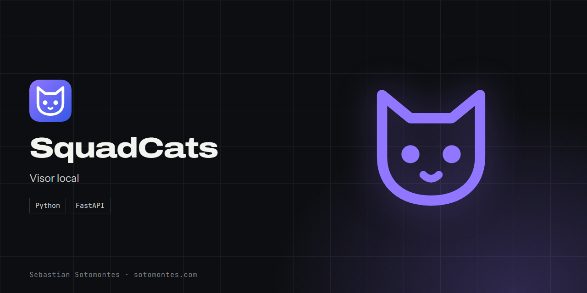
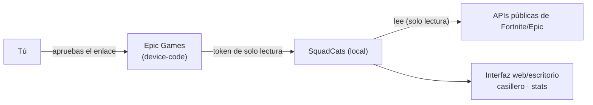

Visor del casillero de Fortnite en una app web local, con inicio de sesión oficial por device-code.

<a href="https://sotomontes.com/#squadcats"><b>Ver en sotomontes.com</b></a> · <a href="#cómo-se-usa">Cómo se usa</a> · <a href="#cómo-funciona-por-dentro">Cómo funciona</a> · <a href="#novedades">Novedades</a>

| Ficha técnica | |
|---|---|
| **Autor** | Sebastian Sotomontes |
| **Tipo** | Visor local |
| **Plataforma** | Windows, app web local |
| **Versión** | 1.0 |
| **Estado** | Funcional |
| **Stack** | Python · FastAPI |
| **Código** | Privado. Esta página es solo una presentación. |

---

## Qué es

SquadCats muestra el casillero de tu cuenta de Fortnite de forma ordenada, con imágenes. Corre como app web local y también como app de escritorio, y usa el inicio de sesión oficial de Epic, sin pedir nunca tu contraseña.

## Novedades

- Versión web local y de escritorio con la misma lógica.

## Cómo se usa

1. Abre SquadCats. Se abre en tu navegador, dentro de tu propio equipo.
2. Inicia sesión: abre el enlace oficial de Epic y aprueba el acceso.
3. Recorre tu **casillero**: skins, picos, alas, gestos y demás cosméticos.
4. Consulta tus **estadísticas** y arma tu **lista de deseos**.
5. Guarda otras cuentas tuyas para cambiar entre ellas.

## Funciones

- **Inicio de sesión oficial** por device-code, sin pedir contraseñas.
- **Casillero** con cosméticos e imágenes.
- **Estadísticas**, lista de deseos y cuentas guardadas.
- **Todo local**: los tokens nunca salen de tu PC.

## Detalles

- Solo lectura: no modifica la cuenta ni hace acciones.
- Cada cuenta la autoriza su dueño. No prueba contraseñas ni sirve con cuentas ajenas.

## Privacidad y seguridad

Corre solo en tu PC y el token nunca sale de ahí.

## Cómo funciona por dentro

### Cómo funciona

Epic ofrece un inicio de sesión **sin contraseñas** llamado **device-code**: la app pide un código, tú abres un
enlace de Epic, lo apruebas con tu cuenta y Epic le entrega a la app un **token** de solo lectura. Con ese token,
SquadCats consulta las **APIs públicas de Fortnite/Epic** (perfil, casillero, estadísticas) y las muestra con imágenes.
Todo corre en `127.0.0.1`: el token se guarda **en tu equipo** y nada se envía a terceros.

### Estructura

El código está en [`fortnite_locker/`]:

| Archivo | Contenido |
|---|---|
| `epic_auth.py` | Inicio de sesión device-code y manejo de tokens |
| `locker.py`, `cosmetics.py` | Lectura (solo lectura) de la API de Fortnite |
| `webapp.py`, `run.py` | Interfaz web local (FastAPI) |
| `gui.py` | Interfaz de escritorio |
| `accounts.py`, `wishlist.py` | Cuentas guardadas y lista de deseos |

### Tecnologías

- **Python 3** + **FastAPI** (servidor local) y biblioteca de interfaz de escritorio.
- Flujo **OAuth device-code** oficial de Epic; peticiones de **solo lectura** a las APIs públicas.

### Seguridad y alcance

- **Solo lectura**: no modifica la cuenta ni realiza acciones; solo muestra lo que ya tienes.
- **No es un "checker"**: no prueba contraseñas ni funciona con cuentas de otras personas; cada cuenta la autorizas tú mismo.
- Las credenciales del cliente de Epic que usa el flujo son **constantes públicas** conocidas; no se guardan secretos tuyos.

---

© 2026 Sebastian Sotomontes. Todos los derechos reservados.
